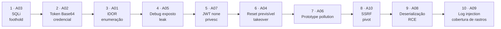
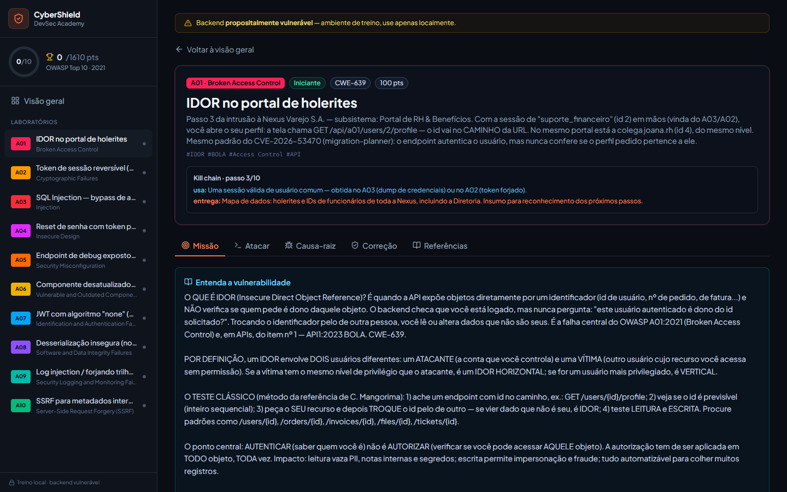
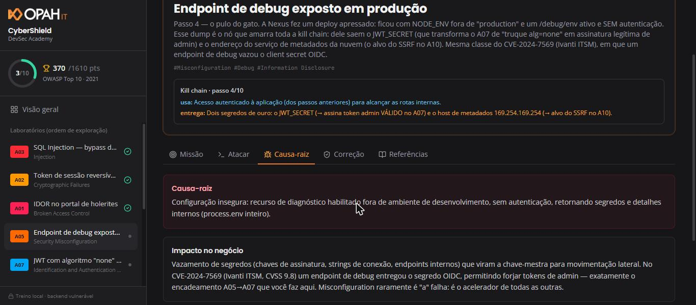
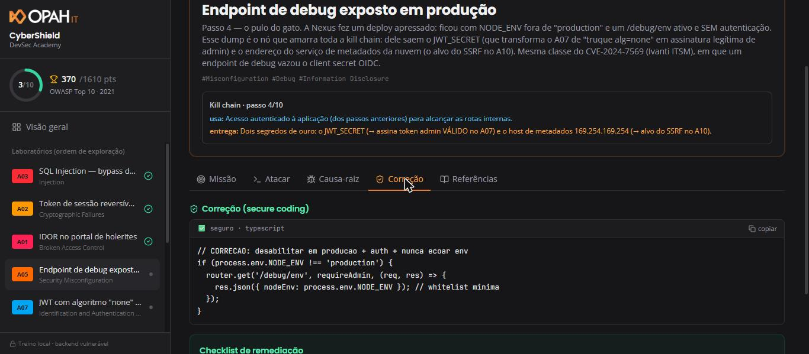

<div align="center">

# 🛡️ CyberShield DevSec Academy

**Plataforma hands-on de AppSec para desenvolvedores — OWASP Top 10 (2021) em uma kill chain encadeada.**


</div>

> ⚠️ **Ambiente de treinamento.** O backend é **intencionalmente vulnerável e realmente explorável**. Rode **apenas localmente**; nunca exponha à internet nem reutilize este código em produção.

---

## Sumário

- [Visão geral](#visão-geral)
- [Novidades desta versão](#novidades-desta-versão)
- [Como funciona](#como-funciona)
- [Laboratórios](#laboratórios)
- [Kill chain](#kill-chain)
- [Material do professor](#material-do-professor)
- [Screenshots](#screenshots)
- [Quick start](#quick-start)
- [Scripts](#scripts)
- [Configuração](#configuração)
- [Arquitetura](#arquitetura)
- [Garantias de segurança do host](#garantias-de-segurança-do-host)
- [Testes](#testes)
- [Referências](#referências)

---

## Visão geral

| Item | Detalhe |
|------|---------|
| **Público-alvo** | Desenvolvedores que querem aprender secure coding atacando e corrigindo falhas reais |
| **Conteúdo** | 10 laboratórios, um por categoria do OWASP Top 10 (2021), totalizando **1.610 pts** |
| **Narrativa** | Todos os labs são subsistemas de uma empresa fictícia (*Nexus Varejo S.A.*) e formam um pentest black-box encadeado |
| **Ferramentas embutidas** | Console HTTP (repeater estilo Burp), workbench com Base64, JWT, hash, URL, CRLF, prototype pollution e `node-serialize` |
| **Progresso** | Salvo no `localStorage` do navegador |
| **Banco** | SQLite em memória (zero setup); Postgres/Supabase opcional |
| **Identidade visual** | Opah IT (Poppins/Open Sans/JetBrains Mono, fontes locais em `public/fonts`; laranja `#ee7d30` / grafite `#1e1e20`) |

## Novidades desta versão

- **Identidade visual Opah IT** — tipografia e paleta trocadas para a marca (ver `src/index.css`); fontes auto-hospedadas em `public/fonts`, sem dependência de CDN.
- **Dashboard e catálogo redesenhados** para um visual mais sóbrio (hairlines, raios pequenos, lista densa em vez de grade de cards).
- **Navegação corrigida pela kill chain real**: sidebar, catálogo e o botão "Continuar" agora seguem a ordem de exploração (`killChain.step`), não o número OWASP — o A08 depende de um achado do A10, que vinha depois dele na lista antiga.
- **Workbench de interceptação mais tolerante**: o parser de requisição crua não exige mais a linha em branco entre cabeçalhos e corpo (evita o erro genérico `Invalid name` ao editar a requisição à mão).
- **A04 (reset de senha)** ganhou uma caixa de e-mail simulada (`GET /api/a04/mailbox/:username`) com o token mascarado por DLP — reforça que ler o e-mail não é o caminho; é preciso prever o token.
- **A09 (log injection) redesenhado**: a exploração passou de um único `\n` para encadear log injection (CRLF) com uma falha de encoding no painel do SOC (`GET /api/a09/dashboard`), que renderiza o log como HTML sem escapar. Só a combinação evento forjado + `<script>` libera a flag.
- **Gabarito do professor em PDF** — ver [Material do professor](#material-do-professor).

## Como funciona

Cada laboratório conduz o aluno por quatro etapas:

| # | Etapa | O que acontece |
|---|-------|----------------|
| 1 | **Atacar** | Dispare requisições HTTP cruas contra o endpoint vulnerável; a flag aparece realçada na resposta |
| 2 | **Entender** | Veja a causa-raiz e o código exato que o dev escreveu |
| 3 | **Corrigir** | Estude a versão segura (secure coding) e o checklist de remediação |
| 4 | **Referenciar** | Aprofunde com OWASP, CWE e CVEs relacionados |

As requisições de exemplo são *baselines* legítimos: respostas `401/400/403/500` nelas são **intencionais**. O aluno precisa adulterar a requisição para explorar; o payload só aparece nas dicas (opt-in) e no writeup.

## Laboratórios

| OWASP | Lab | CWE | Nível | Pts | Passo na kill chain |
|-------|-----|-----|-------|----:|:-------------------:|
| A01 | IDOR no portal de holerites | CWE-639 | Iniciante | 100 | 3 |
| A02 | Token de sessão reversível (Base64 não é cifra) | CWE-311 | Iniciante | 120 | 2 |
| A03 | SQL Injection — bypass de autenticação e dump de dados | CWE-89 | Intermediário | 150 | 1 |
| A04 | Reset de senha com token previsível | CWE-640 | Avançado | 200 | 6 |
| A05 | Endpoint de debug exposto em produção | CWE-16 | Iniciante | 120 | 4 |
| A06 | Componente desatualizado com CVE conhecido (prototype pollution) | CWE-1104 | Intermediário | 150 | 7 |
| A07 | JWT com algoritmo `none` (ou segredo vazado) | CWE-347 | Avançado | 200 | 5 |
| A08 | Desserialização insegura (`node-serialize` RCE) | CWE-502 | Avançado | 220 | 9 |
| A09 | Log injection → Stored XSS no dashboard do SOC | CWE-117 + CWE-79 | Intermediário | 150 | 10 |
| A10 | SSRF para metadados internos | CWE-918 | Avançado | 200 | 8 |

## Kill chain

O achado de um lab alimenta o próximo. Seguindo a ordem, o aluno vive um ataque encadeado real; cada lab também é resolvível de forma independente.



## Material do professor

[`docs/Gabarito_Professor_OWASP_Top10_CyberShield.pdf`](docs/Gabarito_Professor_OWASP_Top10_CyberShield.pdf) traz, para os 10 laboratórios, o objetivo, o caminho de exploração validado contra `scripts/test-labs.mjs`, a flag esperada e os critérios de correção (causa-raiz, impacto, código vulnerável/seguro, checklist). É gerado a partir de `server/labs/metadata.ts` — a mesma fonte que o backend usa para validar as flags — então qualquer mudança nos labs deve vir acompanhada de uma nova geração desse PDF.

> 🔒 **Uso restrito ao corpo docente.** O arquivo contém todas as flags; não distribua aos alunos.

## Screenshots

| Missão do lab | Workbench de ataque |
|:---:|:---:|
|  |  |
| **Causa-raiz** | **Correção** |
|  |  |

## Quick start

**Pré-requisitos:** Node.js 22+ (o backend usa `node:sqlite`) e npm.

```bash
git clone https://github.com/Cyber-Opah/CyberShield-DevSec-Academy.git
cd CyberShield-DevSec-Academy
git checkout development

npm install --legacy-peer-deps
npm run dev
```

| Serviço | URL |
|---------|-----|
| Frontend (React/Vite) | http://localhost:3000 |
| Backend (Express + SQLite) | http://localhost:4000/api |

O Vite faz proxy de `/api` → `:4000`, então basta abrir a porta 3000.

## Trilha de Privacidade e LGPD (rascunho)

Segunda área do portal, escolhida no seletor **Segurança / Privacidade** do menu lateral. Voltada a **todos os colaboradores** (linguagem não técnica), em formato de cenários práticos.

| Item | Detalhe |
|------|---------|
| Conteúdo | 9 módulos (P01–P09) e 31 cenários de decisão, 100% fictícios: `server/labs/privacy.ts`. O P09 é a **avaliação final** (15 cenários complexos): `server/labs/privacyFinal.ts` |
| Casos reais e imagens | Casos com fonte pública, diagramas por módulo e artefatos nos cenários: `server/labs/privacyExtras.ts` |
| Ciclo de cada módulo | Contexto → Decida → Entenda → Boas práticas → Referências |
| Gabarito | Fica só no servidor (`POST /api/privacy/answer`); `GET /api/privacy/modules` não envia respostas |
| Progresso | `localStorage` (chave `cybershield.privacy.v1`), separado do progresso OWASP |

### Trilha CIS Controls v8.1 (rascunho)

Terceira área (aba **CIS**): os **18 controles** do CIS Critical Security Controls, um por módulo (C01–C18), com o mesmo ciclo Contexto → Caso real → Decida → Entenda → Boas práticas → Referências.

| Item | Detalhe |
|------|---------|
| Conteúdo | 18 controles, 36 cenários de decisão (fictícios, com imagem), 18 casos reais com fonte pública |
| Arquivos | `server/labs/cis.ts` (montagem), `cisControls.ts` (títulos e salvaguardas), `cisCases7to12.ts` e `cisCasesRest.ts` (casos), `cisContentA.ts` e `cisContentB.ts` (cenários) |
| API | `GET /api/cis/modules` e `POST /api/cis/answer` (gabarito só no servidor; limite de 180 requisições por minuto por IP) |
| Versão | **v8.1** (publicada em 24/06/2024), a mais recente verificada em cisecurity.org. Não há v9 nem edição 2026 no site oficial |

> ⚠️ **Limites do CIS.** A lista oficial de salvaguardas (IDs, títulos e grupos IG1/IG2/IG3) não pôde ser extraída do site; as salvaguardas exibidas são uma **seleção editorial a conferir no CIS Controls Navigator**. O mapeamento caso → controle é editorial, e dois incidentes aparecem em dois controles (Colonial Pipeline em C01/C06; Uber 2016 em C03/C17). Cada caso lista, em "Limites da fonte", o que não foi confirmado.

> ⚠️ **Rascunho.** Conteúdo educativo, não é parecer jurídico. Exige revisão de Privacidade/Jurídico antes de uso externo. Itens marcados com `[inserir ...]` (canal do encarregado/DPO, responsável jurídico) e a resolução vigente da ANPD sobre incidentes ainda precisam ser validados.

## Scripts

| Script | Função |
|--------|--------|
| `npm run dev` | Sobe API + Web juntos (`concurrently`) |
| `npm run dev:web` | Só o frontend (Vite, porta 3000) |
| `npm run dev:api` | Só a API (`tsx watch`) |
| `npm run start:api` | API sem watch |
| `npm run build` | Build de produção do frontend |
| `npm run preview` | Serve o build localmente |
| `npm run lint` | Type-check (`tsc --noEmit`) |
| `npm run test:labs` | Suíte E2E dos 10 labs |
| `npm run test:tools` | Testes das ferramentas do workbench |
| `npm run db:setup` | Cria schema e dados-semente no Postgres/Supabase |

## Configuração

Sem `.env`, tudo funciona com SQLite em memória. Para customizar, copie `.env.example` para `.env`:

| Variável | Obrigatória | Descrição |
|----------|:-----------:|-----------|
| `DATABASE_URL` | Não | Connection string Postgres/Supabase. Sem ela, usa SQLite em memória. Depois de definir, rode `npm run db:setup` |
| `API_PORT` | Não | Porta do backend (padrão `4000`) |
| `GEMINI_API_KEY` | Não | Presente no template; veja `.env.example` |
| `APP_URL` | Não | URL de hospedagem, usada pelo template |

> 🔐 Nunca versione o `.env` real (já está no `.gitignore`). Se uma credencial vazar, rotacione imediatamente.

## Arquitetura

```
src/                         Frontend React
  App.tsx                    shell: sidebar + dashboard + lab
  academy/
    api.ts, hooks.ts         cliente HTTP, labs e progresso (localStorage)
    types.ts                 tipos (espelham metadados do backend)
    lib/tools.ts             utilitários do workbench
    components/              Dashboard, Sidebar, LabView, HttpRepeater,
                             ExploitToolkit, KillChainMap, LabCatalog, ui

server/                      Backend Express (rode só local)
  index.ts                   app + /api/labs + /api/validate-flag
  db.ts, dbSetup.ts          SQLite (node:sqlite) ou Postgres, com seed vulnerável
  labs/
    metadata.ts              fonte única: objetivo, writeup, correção, refs, flag
    routes.ts                endpoints vulneráveis (A01..A10)

scripts/                     test-labs.mjs, test-tools.mts
legacy/                      versão anterior do projeto (arquivada)
docs/screenshots/            imagens deste README
```

A `flag` fica só no backend: `GET /api/labs` expõe os metadados sem esse campo e a validação ocorre em `/api/validate-flag`.

## Garantias de segurança do host

Mesmo sendo "vulnerável", o backend não coloca a máquina do aluno em risco:

- ✅ **Sem execução de comandos no SO** (nenhum `child_process`).
- ✅ **Sem egress de rede real** no lab de SSRF: usa um *resolver mock* interno.
- ✅ **Prototype pollution** (A06) é revertida imediatamente após a prova.
- ✅ **Banco em memória** (`:memory:`), recriado a cada start.

> O Vite sobe com `--host=0.0.0.0`, deixando a porta 3000 acessível na sua rede local. Em redes não confiáveis, rode `npx vite --port=3000` (somente `localhost`) e `npm run dev:api` separadamente.

## Testes

Os testes de lab exigem um servidor **recém-iniciado** (seed limpo), pois o A04 reseta a senha do admin.

```bash
npm run dev:api        # terminal 1
npm run test:labs      # terminal 2: exploit positivo + casos negativos dos 10 labs
npm run test:tools     # ferramentas do workbench
npm run lint           # type-check
```

## Referências

- [OWASP Top 10 (2021)](https://owasp.org/Top10/)
- [OWASP Cheat Sheet Series](https://cheatsheetseries.owasp.org/)
- [CWE / MITRE](https://cwe.mitre.org/)

---

**Licença:** [inserir licença definida pela Opah IT]  ·  **Mantenedores:** Opah IT — DevSec Academy

## Trilha CIS Controls v8.1: cenários avançados (rascunho)

Além dos 2 cenários por controle, cada um dos 18 controles ganhou 2 cenários avançados (`cNN-s3`, baseado no padrão do caso real do controle, e `cNN-s4`, fictício com trade-offs) e a trilha tem a **Avaliação final integrada** (C19, 15 cenários que cruzam controles). Total: 87 cenários. Numeração de salvaguardas continua sendo seleção editorial a conferir no CIS Controls Navigator.

## Trilha ISO/IEC 27001:2022 (rascunho)

Área "ISO" no seletor lateral: **12 módulos** (cláusulas 4 a 10, os 4 temas do Anexo A e a avaliação final em formato de auditoria), **48 cenários** complexos, **11 casos reais** com fonte pública e "Limites da fonte". Objetivo: apoiar a preparação da Opah, que **ainda não é certificada**, para a certificação.

- Código: `server/labs/iso*.ts` (montador em `iso.ts`), rotas `/api/iso/modules` e `/api/iso/answer`.
- A norma é paga: o conteúdo é paráfrase didática. Numeração de requisitos e controles é seleção editorial; conferir na edição oficial (ISO/IEC 27001:2022 e 27002:2022).
- Não verificado em fonte oficial da ISO (páginas deram 403): data de publicação e prazo de transição; conferir antes de uso externo.
- Mapeamento caso real → cláusula/controle é editorial e não afirma nada sobre a certificação das organizações citadas.
- Pendente: `[inserir escopo do SGSI Opah]` e revisão de Segurança da Informação, Compliance e AI Guild.

## Trilha LLM: OWASP Top 10 for LLM Applications 2025 (rascunho)

Área "LLM" no seletor lateral: **11 módulos** (LLM01 a LLM10 e avaliação final integrada), **45 cenários** (por módulo: 1 médio e 2 avançados, incluindo chats multi-turn) e **10 casos reais** com fonte pública e "Limites da fonte". Código em `server/labs/llm*.ts`, rotas `/api/llm/modules` e `/api/llm/answer`.

- Estrutura temática inspirada no range público [LLMVault](https://github.com/CyberSunil/LLMVault) (MIT): categorias OWASP, progressão core → avançado e cenários "live". Só o README e as listagens foram lidos; **nenhum texto, flag ou payload do LLMVault foi copiado**, e a marca LLMVault™ não é da Opah. Para praticar na mão, rode o LLMVault isolado, sem expor à rede, e revise o código antes (o README cita `OPENAI_API_KEY` opcional, a confirmar se há chamada a API externa).
- Casos com fonte fraca, marcados nos cards: Replit (alegações de cliente), Air Canada (resumos de escritórios; decisão não lida), Slack AI (fonte única), EchoLeak (sem CVSS).
- Nomes em português das categorias são tradução editorial; confira em genai.owasp.org.

## Testes de conteúdo

`npm run test:content` valida as 4 trilhas (LGPD, CIS, ISO, LLM): 1 gabarito por cenário, ids únicos, feedback em todas as opções, visuais presentes, sem vazamento do gabarito na API, sem credenciais ou e-mails reais, casos com fonte https e ressalva e, principalmente, que **o tamanho e a posição da opção correta não entreguem a resposta** (correta mais longa em no máximo 40% dos cenários; razão média correta/erradas entre 0,85 e 1,20; nenhuma posição com mais de 45% das corretas).

## Laboratório de prompts (área LLM)

Em **LLM → Laboratório de prompts** o colaborador digita mensagens para **10 assistentes simulados** e propositalmente vulneráveis (um por categoria OWASP LLM01 a LLM10), tenta capturar uma flag fictícia `OPAH-LLM{...}`, valida no servidor e vê "por que funcionou e como corrigir". Há 3 dicas progressivas por lab; progresso em `localStorage` (`cybershield.llmlab.v1`).

- **Sem LLM real nem API externa:** cada assistente é uma regra determinística em `server/labs/llmLab.ts` (como os labs core de ranges de treinamento). Flags e lógica ficam só no servidor; a API pública (`/api/llm-lab/labs`) não expõe flags nem dicas. Rotas: `chat`, `hint`, `submit` (flag comparada por hash, tempo constante), com limite de 180 req/min/IP, mensagem de até 400 caracteres e histórico de até 10 mensagens.
- O lab 5 avalia expressões `{{...}}` só com aritmética de dígitos e operadores (sem `eval` de texto livre); há teste para isso.
- Os assistentes são originais; nenhum código, flag ou payload do LLMVault foi copiado. Limitação: por serem regras, aceitam as técnicas previstas (e variações de redação), não qualquer prompt criativo como um modelo real. O modo "live" com modelo local (Ollama) como no LLMVault **não** foi implementado.
- Testes: `npm run test:content` (53 testes) cobre cada lab (não vaza com mensagens ingênuas, vaza com a técnica da dica, validação de flag, entradas inválidas).

## Jornada Security Champion e selo (rascunho)

Botão **Jornada Security Champion** no topo da barra lateral: a rota das seis trilhas em ordem sugerida (LGPD → CIS → ISO 27001 → OWASP web → LLM trilha → LLM laboratório), com progresso por trilha, critérios, emissão e **verificação** do selo.

- **Nível** (Bronze 70%, Prata 85%, Ouro 100%) = a trilha **mais atrasada** (gargalo). Unidade: cenário respondido corretamente, lab web resolvido ou flag de prompt capturada. Limites são premissa editorial **[a validar com a AI Guild]** (`src/academy/championCore.ts`, compartilhado entre front e servidor).
- **Selo:** anel de 6 segmentos (um por trilha) preenchido pelo progresso real, escudo com check e nível. **Credencial** 1200x675 com nome, nível, conclusão por trilha, data e ID. Exporta PNG (credencial e só o selo) e imprime em A4 paisagem / PDF (`championSvg.ts`).

### Registro no servidor (substitui o selo autodeclarado)
- **Progresso validado pelo servidor:** só entra no registro quando o servidor confere a resposta ou a flag (`/api/*/answer`, `/api/validate-flag`, `/api/llm-lab/submit`). O cliente não "declara" progresso; editar o `localStorage` não gera selo.
- **Selo assinado:** a emissão (`POST /api/champion/issue`) recalcula o nível a partir do registro e grava o selo com **HMAC-SHA256**. O ID (`SC-` + 10 caracteres) não revela a chave do aluno. **Verificação pública** em `GET /api/champion/verify/:id` e na seção "Verificar um selo" da jornada (também abre com `/?verificar=SC-...`). Se o arquivo do registro for adulterado ou a chave de assinatura mudar, a verificação falha (testado).
- **Persistência:** `data/champion-ledger.json` (gravação atômica; fora do git). A chave de assinatura vem de `CHAMPION_SIGNING_KEY` ou é gerada em `data/.signing-key`. Faça backup de `data/` e **não** perca a chave, ou os selos emitidos deixam de validar.
- **Privacidade (LGPD):** o único dado pessoal é o nome digitado na emissão, visível a quem tiver o ID do selo; o aluno vê esse aviso antes de emitir e pode **remover o selo** ou **apagar todos os seus dados** (`DELETE /api/champion/seal` e `/api/champion/me`). Verificação e emissão têm limite de 180 req/min por IP, e o registro tem teto de alunos.
- Testes: `npm run test:content` (73 testes), incluindo `scripts/test-champion-server.mts` (progresso só por registro, gargalo, emissão, assinatura, adulteração, persistência, remoção/apagamento, limites).

### Limitações que continuam (leia antes de uso oficial)
- **Identidade pseudônima, não autenticação.** O aluno é uma chave anônima (UUID v4 no navegador, header `x-learner-id`). Quem tiver a chave age como o aluno; trocar de navegador ou limpar os dados começa do zero. Para vincular o selo a uma **pessoa real** é preciso integrar o login corporativo **[inserir provedor SSO Opah]** e substituir `learnerOf` em `server/index.ts`. O nome no selo continua sendo digitado pelo aluno.
- **Quizzes automatizáveis:** o gabarito tem 3 ou 4 opções e um script pode tentar todas dentro do limite de requisições. O registro impede fraude casual, não quem automatiza as respostas; combine com SSO e, se necessário, revisão humana na emissão.
- **Progresso anterior a esta versão não conta:** só respostas validadas pelo servidor depois dela entram no registro.
- **Servidor único:** o registro é um arquivo local (sem banco nem alta disponibilidade). Para produção, usar banco e gestão de segredos.
- **Aprovação pendente:** o texto do selo diz "selo interno de conclusão de trilha, não é certificação profissional" e traz o marcador `[inserir responsável pela emissão do selo na Opah]`; aprovação da AI Guild e da Segurança da Informação.
