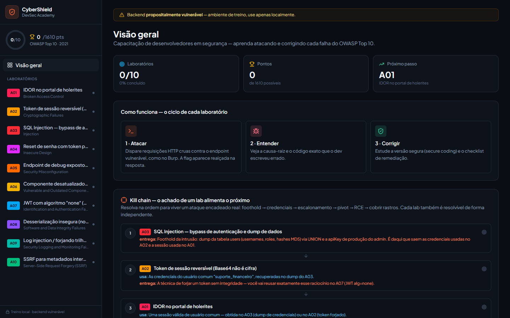
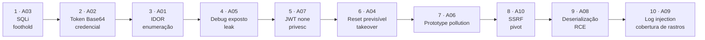
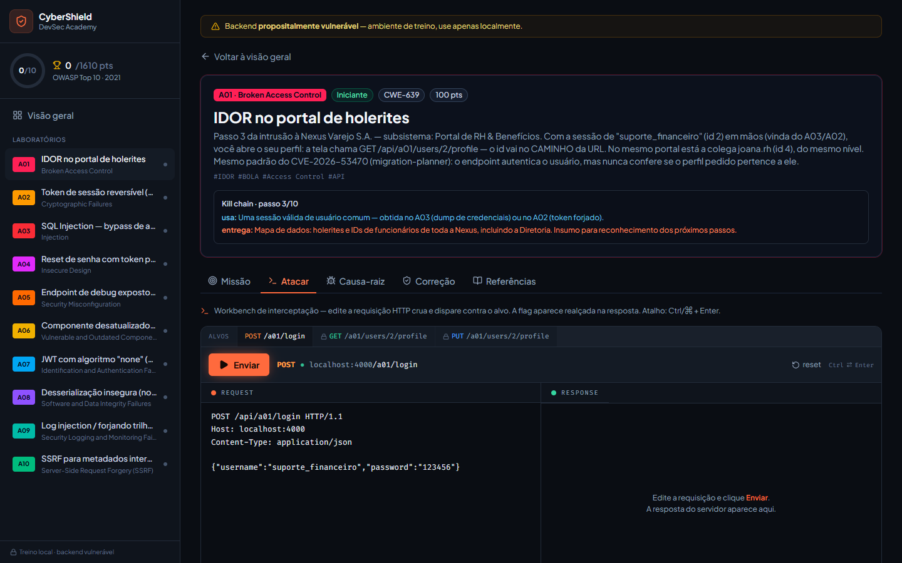

<div align="center">

# 🛡️ CyberShield DevSec Academy

**Plataforma hands-on de AppSec para desenvolvedores — OWASP Top 10 (2021) em uma kill chain encadeada.**




</div>

> ⚠️ **Ambiente de treinamento.** O backend é **intencionalmente vulnerável e realmente explorável**. Rode **apenas localmente**; nunca exponha à internet nem reutilize este código em produção.

---

## Sumário

- [Visão geral](#visão-geral)
- [Como funciona](#como-funciona)
- [Laboratórios](#laboratórios)
- [Kill chain](#kill-chain)
- [Screenshots](#screenshots)
- [Quick start](#quick-start)
- [Scripts](#scripts)
- [Configuração](#configuração)
- [Arquitetura](#arquitetura)
- [Garantias de segurança do host](#garantias-de-segurança-do-host)
- [Testes](#testes)
- [Referências](#referências)

---

## Visão geral

| Item | Detalhe |
|------|---------|
| **Público-alvo** | Desenvolvedores que querem aprender secure coding atacando e corrigindo falhas reais |
| **Conteúdo** | 10 laboratórios, um por categoria do OWASP Top 10 (2021), totalizando **1.610 pts** |
| **Narrativa** | Todos os labs são subsistemas de uma empresa fictícia (*Nexus Varejo S.A.*) e formam um pentest black-box encadeado |
| **Ferramentas embutidas** | Console HTTP (repeater estilo Burp), workbench com Base64, JWT, hash, URL, CRLF, prototype pollution e `node-serialize` |
| **Progresso** | Salvo no `localStorage` do navegador |
| **Banco** | SQLite em memória (zero setup); Postgres/Supabase opcional |

## Como funciona

Cada laboratório conduz o aluno por quatro etapas:

| # | Etapa | O que acontece |
|---|-------|----------------|
| 1 | **Atacar** | Dispare requisições HTTP cruas contra o endpoint vulnerável; a flag aparece realçada na resposta |
| 2 | **Entender** | Veja a causa-raiz e o código exato que o dev escreveu |
| 3 | **Corrigir** | Estude a versão segura (secure coding) e o checklist de remediação |
| 4 | **Referenciar** | Aprofunde com OWASP, CWE e CVEs relacionados |

As requisições de exemplo são *baselines* legítimos: respostas `401/400/403/500` nelas são **intencionais**. O aluno precisa adulterar a requisição para explorar; o payload só aparece nas dicas (opt-in) e no writeup.

## Laboratórios

| OWASP | Lab | CWE | Nível | Pts | Passo na kill chain |
|-------|-----|-----|-------|----:|:-------------------:|
| A01 | IDOR no portal de holerites | CWE-639 | Iniciante | 100 | 3 |
| A02 | Token de sessão reversível (Base64 não é cifra) | CWE-311 | Iniciante | 120 | 2 |
| A03 | SQL Injection — bypass de autenticação e dump de dados | CWE-89 | Intermediário | 150 | 1 |
| A04 | Reset de senha com token previsível | CWE-640 | Avançado | 200 | 6 |
| A05 | Endpoint de debug exposto em produção | CWE-16 | Iniciante | 120 | 4 |
| A06 | Componente desatualizado com CVE conhecido (prototype pollution) | CWE-1104 | Intermediário | 150 | 7 |
| A07 | JWT com algoritmo `none` (ou segredo vazado) | CWE-347 | Avançado | 200 | 5 |
| A08 | Desserialização insegura (`node-serialize` RCE) | CWE-502 | Avançado | 220 | 9 |
| A09 | Log injection / forjando trilha de auditoria | CWE-117 | Intermediário | 150 | 10 |
| A10 | SSRF para metadados internos | CWE-918 | Avançado | 200 | 8 |

## Kill chain

O achado de um lab alimenta o próximo. Seguindo a ordem, o aluno vive um ataque encadeado real; cada lab também é resolvível de forma independente.



## Screenshots

| Missão do lab | Workbench de ataque |
|:---:|:---:|
|  |  |
| **Causa-raiz** | **Correção** |
|  |  |

## Quick start

**Pré-requisitos:** Node.js 22+ (o backend usa `node:sqlite`) e npm.

```bash
git clone https://github.com/Cyber-Opah/CyberShield-DevSec-Academy.git
cd CyberShield-DevSec-Academy
git checkout develop

npm install --legacy-peer-deps
npm run dev
```

| Serviço | URL |
|---------|-----|
| Frontend (React/Vite) | http://localhost:3000 |
| Backend (Express + SQLite) | http://localhost:4000/api |

O Vite faz proxy de `/api` → `:4000`, então basta abrir a porta 3000.

## Scripts

| Script | Função |
|--------|--------|
| `npm run dev` | Sobe API + Web juntos (`concurrently`) |
| `npm run dev:web` | Só o frontend (Vite, porta 3000) |
| `npm run dev:api` | Só a API (`tsx watch`) |
| `npm run start:api` | API sem watch |
| `npm run build` | Build de produção do frontend |
| `npm run preview` | Serve o build localmente |
| `npm run lint` | Type-check (`tsc --noEmit`) |
| `npm run test:labs` | Suíte E2E dos 10 labs |
| `npm run test:tools` | Testes das ferramentas do workbench |
| `npm run db:setup` | Cria schema e dados-semente no Postgres/Supabase |

## Configuração

Sem `.env`, tudo funciona com SQLite em memória. Para customizar, copie `.env.example` para `.env`:

| Variável | Obrigatória | Descrição |
|----------|:-----------:|-----------|
| `DATABASE_URL` | Não | Connection string Postgres/Supabase. Sem ela, usa SQLite em memória. Depois de definir, rode `npm run db:setup` |
| `API_PORT` | Não | Porta do backend (padrão `4000`) |
| `GEMINI_API_KEY` | Não | Presente no template; veja `.env.example` |
| `APP_URL` | Não | URL de hospedagem, usada pelo template |

> 🔐 Nunca versione o `.env` real (já está no `.gitignore`). Se uma credencial vazar, rotacione imediatamente.

## Arquitetura

```
src/                         Frontend React
  App.tsx                    shell: sidebar + dashboard + lab
  academy/
    api.ts, hooks.ts         cliente HTTP, labs e progresso (localStorage)
    types.ts                 tipos (espelham metadados do backend)
    lib/tools.ts             utilitários do workbench
    components/              Dashboard, Sidebar, LabView, HttpRepeater,
                             ExploitToolkit, KillChainMap, LabCatalog, ui

server/                      Backend Express (rode só local)
  index.ts                   app + /api/labs + /api/validate-flag
  db.ts, dbSetup.ts          SQLite (node:sqlite) ou Postgres, com seed vulnerável
  labs/
    metadata.ts              fonte única: objetivo, writeup, correção, refs, flag
    routes.ts                endpoints vulneráveis (A01..A10)

scripts/                     test-labs.mjs, test-tools.mts
legacy/                      versão anterior do projeto (arquivada)
docs/screenshots/            imagens deste README
```

A `flag` fica só no backend: `GET /api/labs` expõe os metadados sem esse campo e a validação ocorre em `/api/validate-flag`.

## Garantias de segurança do host

Mesmo sendo "vulnerável", o backend não coloca a máquina do aluno em risco:

- ✅ **Sem execução de comandos no SO** (nenhum `child_process`).
- ✅ **Sem egress de rede real** no lab de SSRF: usa um *resolver mock* interno.
- ✅ **Prototype pollution** (A06) é revertida imediatamente após a prova.
- ✅ **Banco em memória** (`:memory:`), recriado a cada start.

> O Vite sobe com `--host=0.0.0.0`, deixando a porta 3000 acessível na sua rede local. Em redes não confiáveis, rode `npx vite --port=3000` (somente `localhost`) e `npm run dev:api` separadamente.

## Testes

Os testes de lab exigem um servidor **recém-iniciado** (seed limpo), pois o A04 reseta a senha do admin.

```bash
npm run dev:api        # terminal 1
npm run test:labs      # terminal 2: exploit positivo + casos negativos dos 10 labs
npm run test:tools     # ferramentas do workbench
npm run lint           # type-check
```

## Referências

- [OWASP Top 10 (2021)](https://owasp.org/Top10/)
- [OWASP Cheat Sheet Series](https://cheatsheetseries.owasp.org/)
- [CWE / MITRE](https://cwe.mitre.org/)

---

**Licença:** [inserir licença definida pela Opah IT]  ·  **Mantenedores:** [inserir time responsável]
